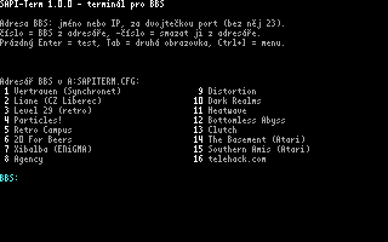
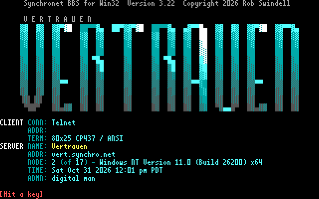
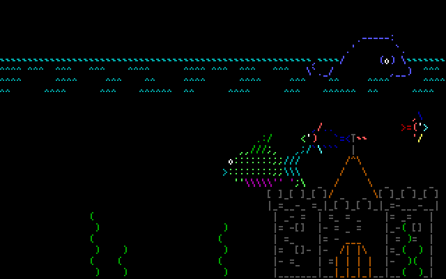
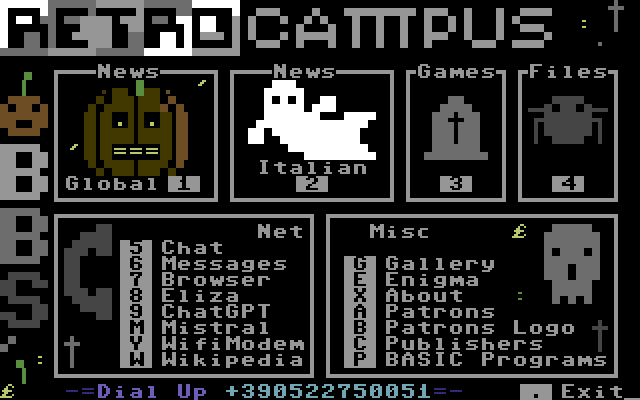
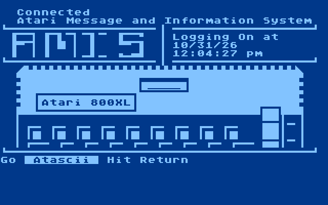
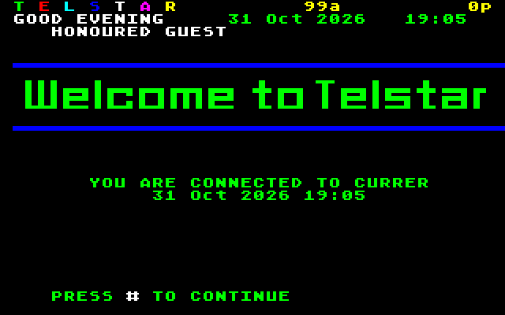

# SAPI-Term

Terminál pro internetové BBS (telnet) pro **Tesla SAPI-1** v sestavě „V“ z desek Libora Lasoty, se síťovou kartou
**DPI-1L**. Program pro CP/M `SAPITERM.COM`, po skončení se vrací do CP/M.

> *English: a telnet BBS terminal for the Czechoslovak Tesla SAPI-1 computer with Libor Lasota's "V" boards and
> the DPI-1L network card, CP/M. ANSI-BBS and VT100 in 80×25 colour on CGA-1V or 64×20 on AND-1V, PETSCII,
> ATASCII and Viewdata, XMODEM and YMODEM downloads. Tested on a real SAPI-1 and in the SAPIemu emulator.
> The documentation is in Czech.*

| Úvodní obrazovka | Vertrauen (ANSI) | telehack.com (akvárium) |
|---|---|---|
|  |  |  |
| **Retro Campus (PETSCII)** | **Southern Amis (ATASCII)** | **Telstar (Viewdata)** |
|  |  |  |

*Snímky z emulátoru SAPIemu, CGA-1V. Obrazovky BBS patří jejich provozovatelům, adresy jsou dole.*

## Co umí

- ANSI-BBS a VT100: 80×25 v 16 barvách na CGA-1V (vlastní písmo 4×8), nebo 64×20 na AND-1V. Druhá karta ukazuje
  stav spojení.
- 40 sloupců s písmem Sharp MZ-800 a terminály C64 (PETSCII), Atari (ATASCII) a Prestel (Viewdata) s jejich
  písmy a barvami.
- Znakové sady BBS UTF-8, Latin-2, CP1250, CP852, Kamenický a KOI-8čs, česky se píše z EKL-1.
- Adresář 16 BBS, rychlost linky jako modem (kvůli ANSI animacím), záznam relace, historie odrolovaných řádků,
  stahování XMODEM a YMODEM, prohlížeč souborů `.ANS`.

## Stažení

V [Releases](https://github.com/mlukasek/SAPI-Term/releases) je `SAPITERM.COM`, `sapiterm.hex` (Intel HEX od
0100h, pro emulátor), `SAPITERM.CFG` s adresářem BBS a testovací obrázky `*.ANS`. Co je nového:
[CHANGELOG.md](CHANGELOG.md).

## Co je potřeba

- SAPI-1 V: JPR-1V, RAM-1V, CP/M;
- CGA-1V nebo AND-1V, nejlépe obě;
- [DPI-1L](https://github.com/mlukasek/SAPI_DPI-1L) s Wi-Fi a [firmwarem](https://github.com/mlukasek/SAPI_DPI-firmware);
- klávesnice EKL-1 nebo Consul 262.3;
- volitelně MPH-1V: zvonek a přesnější čas pro rychlost linky. Bez ní pípá bzučák klávesnice.

Ověřeno na skutečném SAPI-1 V (JPR-1V se 4 MHz, RAM disk ZRD-1V) a v emulátoru
[SAPIemu](https://github.com/mlukasek/SAPIemu) 0.7.0 beta.

## Spuštění

`SAPITERM.COM` a `SAPITERM.CFG` dát na disk CP/M. Bez `SAPITERM.CFG` je adresář prázdný.

- `SAPITERM`: úvodní obrazovka s adresářem, zadá se číslo BBS nebo adresa `host[:port]`;
- `SAPITERM 1` nebo `SAPITERM host[:port]`: rovnou připojí;
- `SAPITERM SOUBOR.ANS`: zobrazí soubor ANSI.

Ctrl+] otevře menu (na BBS i na úvodní obrazovce), K v něm program ukončí. Tab vymění obrazovky CGA-1V a AND-1V.

V SAPIemu: sestava s DPI-1L (`sapi1v_BomberNet.sapi`, nebo `machines/sapi1v_term.sapi` z tohoto repa),
Soubor → Nahrát program do paměti → `sapiterm.hex`, v CP/M `SAVE 135 SAPITERM.COM`.

## Pro vývojáře

- Stav a další kroky: [docs/stav.md](docs/stav.md)
- Jak to funguje (paměť, karty, protokoly): [docs/technika.md](docs/technika.md)
- Překlad, emulátor, testy, pasti: [docs/vyvoj.md](docs/vyvoj.md)
- Rozhodnutí a jejich důvody: [docs/rozhodnuti.md](docs/rozhodnuti.md)
- Zkoušky na skutečném SAPI-1: [docs/hw-otazky.md](docs/hw-otazky.md)

Překlad: `build.cmd` (assembler pasmo 0.5.3 a Python 3) → `build\sapiterm.com` a RAM disk `build\ramdisk.bin`.

## Autoři a práva

- **SAPI-Term:** Martin Lukášek (mlukasek, 8bity.cz), s pomocí Claude (Anthropic). Licence GPLv3, viz
  [LICENSE](LICENSE).
- **Desky „V“:** Libor Lasota.
- **Písma 8×8** v `fonts/c64.txt`, `fonts/atari.txt` a `fonts/mz800.txt` jsou ze znakových ROM Commodore 64,
  Atari 400/800 a Sharp MZ-800 a patří jejich vlastníkům. Česká písmena v `fonts/mz800cs.txt` jsou z písma MZ-800
  a znamének českého CP/M pro MZ-800. Písmo 4×8 a testovací obrázky ANSI jsou vlastní.
- **Obrazovky BBS** na snímcích patří jejich provozovatelům: Vertrauen (`vert.synchro.net`), telehack.com,
  Retro Campus (`bbs.retrocampus.com`), Southern Amis (`southernamis.ddns.net`), Telstar (`glasstty.com:6502`).
